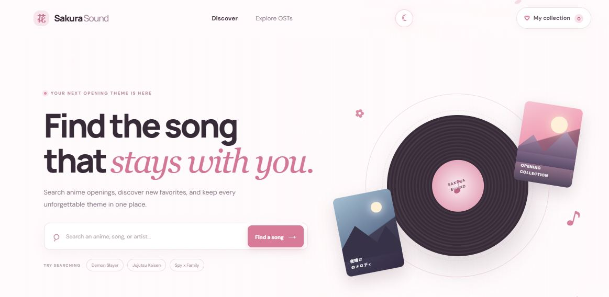

# SakuraSound — Anime OST Finder

Discover anime opening and ending themes, find their album artwork, and listen in a lightweight music player.



## Features

- **Live anime theme catalog** powered by the public [AnimeThemes API](https://animethemes.moe/), with curated picks available as a fallback.
- **Search with suggestions** across anime titles, song names, and artists. Choose a suggestion or search the full catalog.
- **Browse and filter** openings, endings, and saved favorites; sort featured songs alphabetically or by anime year, and load more results.
- **Album artwork and release links** looked up through Apple Music and Deezer, with MusicBrainz and Cover Art Archive artwork as fallbacks. Results are cached in the browser to make repeat visits faster. Some tracks may not have a matching cover.
- **Music player** with play/pause, previous/next, a queue, and a compact sticky player with a seek bar that stays available while scrolling. Play available AnimeThemes previews or search and play embeddable YouTube videos inside SakuraSound.
- **One-click download** for available AnimeThemes audio or theme video. The download endpoint streams eligible media from AnimeThemes and starts a file download directly.
- **MP3 preview downloads** convert available AnimeThemes audio or extract audio from a theme video into a 192 kbps MP3. These are theme previews; full recordings are played from YouTube videos and are not downloaded by SakuraSound.
- **YouTube Music link** opens a search for the selected song, artist, and anime. YouTube Music's free tier is ad-supported.
- **Favorites** saved in the browser, so they remain available on the same device and browser.
- **Light and dark themes**, with Zero Two background artwork, subtle neon accents, and animated details.
- **Tip Me panel** for creator support. Add a Buy Me a Coffee page URL to enable its support link.
- **Responsive layout** for desktop and mobile screens.

## Run locally

Use the Vercel CLI to run the site and its API routes:

```bash
npx vercel dev
```

The catalog can also be viewed from a basic static server, but album artwork lookups and downloads require the Vercel API routes.

## Deploy to Vercel

This is a static site with serverless functions in `api/`. No build command or database is required. Provider-backed features need the relevant optional API keys listed below.

1. Import this GitHub repository into Vercel.
2. Choose **Other** as the framework preset, leave the build command empty, and set the output directory to `.`.
3. Deploy. New commits pushed to the connected branch trigger deployments.

### Enable in-site YouTube playback

SakuraSound searches the YouTube Data API for embeddable videos, then plays a selected result with YouTube's IFrame Player. The separate **Open YouTube Music** link works without an API key.

1. In Google Cloud Console, create a project, enable [YouTube Data API v3](https://console.cloud.google.com/marketplace/product/google/youtube.googleapis.com), and create an API key.
2. Restrict the key to **YouTube Data API v3**. Keep it private; do not add a `NEXT_PUBLIC_` or `VITE_` prefix.
3. In Vercel **Settings → Environment Variables**, add `YOUTUBE_API_KEY` to Production (and Preview if desired), then redeploy.

Google's default quota currently allows 100 `search.list` calls per day. SakuraSound searches only when a listener presses **Play in SakuraSound** and caches repeated searches. Some videos may not be available to embed; listeners can use the YouTube Music link instead. See [YouTube Data API quota](https://developers.google.com/youtube/v3/getting-started#quota) and the [IFrame Player API](https://developers.google.com/youtube/iframe_api_reference).

### Enable AI chat

The floating **Help & AI** button opens SakuraSound's built-in assistant. It can answer questions about finding anime themes and using the player. The **Customer support** link also opens the project's GitHub support page.

AI replies use Vercel AI Gateway from the server-side `/api/ai-chat` route. To enable them:

1. In the Vercel Dashboard, open **AI Gateway** and create an API key.
2. Open the SakuraSound project → **Settings → Environment Variables**.
3. Add `AI_GATEWAY_API_KEY` for Production (and Preview if you want chat on preview deployments). Keep it server-side; do not expose it in browser code or commit it to GitHub.
4. Redeploy the project so the function receives the new variable.

If the key is not configured or the AI provider is unavailable, the chat displays an error and the customer support link remains available. AI responses depend on the selected model and Vercel AI Gateway account configuration.

## Data providers and API routes

- Anime theme metadata and playable media: [AnimeThemes](https://animethemes.moe/)
- Album artwork and music listings: Apple Music / iTunes, Deezer, MusicBrainz, and Cover Art Archive
- `GET /api/album-art` searches providers for a likely album cover and listing.
- `GET /api/youtube-search` finds embeddable YouTube videos using the server-side `YOUTUBE_API_KEY`.
- `GET /api/download` streams an eligible AnimeThemes media file as a download.
- Add `format=mp3` to `GET /api/download` to extract or convert the theme audio using the bundled `ffmpeg-static` binary.

Set `MUSICBRAINZ_CONTACT` in Vercel to a project contact URL or email if you want the album-art API to use it in its User-Agent.

Music and artwork remain the property of their respective rights holders. Availability depends on the providers and the specific anime theme.


## Authentication setup

SakuraSound uses Clerk for sign-up, sign-in, and account profile management. Because the production site uses a `vercel.app` hostname, Clerk Frontend API requests are routed through the same-domain `/__clerk` proxy.

1. Create a Clerk application at [dashboard.clerk.com](https://dashboard.clerk.com) and enable the sign-in methods you want to offer.
2. In Clerk, add `https://sakurasound.vercel.app` as an allowed application origin. Add your local development URL too if needed.
3. In Clerk's API keys page, copy the **Publishable key** and **Secret key**.
4. In Vercel, open SakuraSound → **Settings → Environment Variables**. Add `CLERK_PUBLISHABLE_KEY` and `CLERK_SECRET_KEY` to Production. Keep the secret key private; it is only read by the server-side proxy. Optionally add `CLERK_PROXY_URL` with the value `https://sakurasound.vercel.app/__clerk`.
5. Push or redeploy the latest commit so Vercel builds the proxy route.
6. In Clerk's **Domains** settings, set the Frontend API proxy URL to `https://sakurasound.vercel.app/__clerk`, then use Clerk's **Verify** action.

The client reads the public publishable key and proxy URL from `/api/clerk-config`; the secret key is never sent to the browser. Once configured, the Log in button opens Clerk's secure sign-in/sign-up form, and signed-in users can manage their profile. Saved song favorites remain stored in the browser on that device; syncing them across devices requires a database integration.
